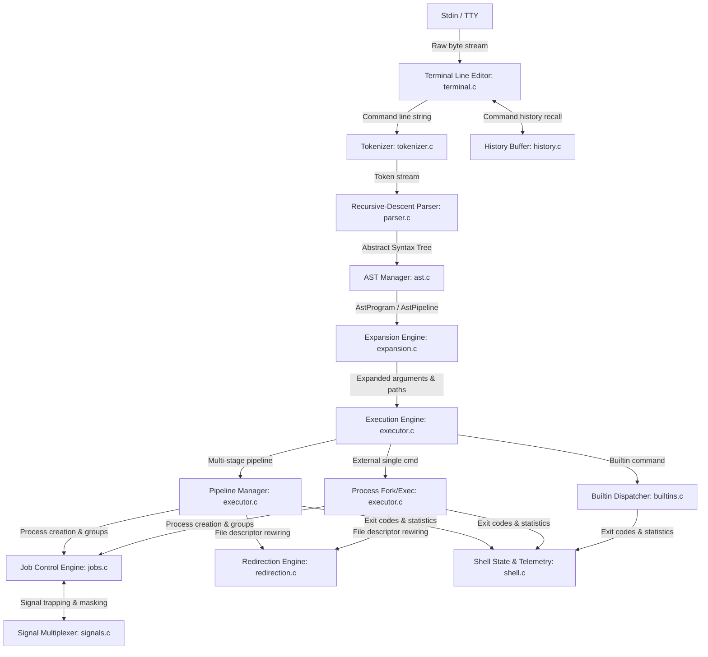

# Shellcraft Subsystem Architecture & Data Flow

This document provides an exhaustive, engineering-grade breakdown of the subsystems comprising **Shellcraft**, detailing design decisions, state machines, and inter-module contracts.

---

## 1. System Architecture Map



---

## 2. Subsystem Breakdown

### 2.1 Terminal Line Editor (`src/terminal.c`, `include/terminal.h`)
- **Role**: Provides interactive CLI line editing without depending on external libraries like GNU Readline.
- **Operating Modes**:
  - **Canonical Mode (Default)**: Used when input is piped or redirected from a non-interactive source (script, file, or pipe). Uses standard `getline()`.
  - **Raw Mode (Interactive)**: Enabled using POSIX `termios`. Clears `ICANON`, `ECHO`, `IEXTEN`, and `IXON`. Sets `VMIN = 1` and `VTIME = 0`.
- **Keybinding Engine**:
  - `Ctrl-A` / `Home`: Moves cursor to the start of the buffer.
  - `Ctrl-E` / `End`: Moves cursor to the end of the buffer.
  - `Ctrl-K`: Kills text from cursor to end of line.
  - `Ctrl-U`: Kills entire line.
  - `Ctrl-L`: Clears screen (`\033[2J\033[H`) and repaints prompt.
  - `Up` / `Down`: Traverses session command history.
  - `Backspace` / `Delete`: Performs character removal with line shifts.
- **Safety Invariant**: Registers `terminal_restore()` via `atexit()` to ensure the host terminal's original termios configuration is restored if the shell crashes or terminates. Forked child processes bypass this via `_exit()`.

---

### 2.2 Lexical Tokenizer (`src/tokenizer.c`, `include/tokenizer.h`)
- **Role**: Scans raw line strings into strongly typed lexical tokens.
- **State Machine**:
  - Handles transitions between `STATE_GENERAL`, `STATE_IN_SINGLE_QUOTE`, `STATE_IN_DOUBLE_QUOTE`, and `STATE_IN_ESCAPE`.
  - **Single Quotes (`'...'`)**: Preserves all literal characters inside quotes verbatim, preventing interpretation of metacharacters and `$`.
  - **Double Quotes (`"..."`)**: Aggregates whitespace-separated words into a single token while permitting variable expansion.
  - **Operator Disambiguation**: Disambiguates single-character vs multi-character operators:
    - `>` vs `>>`
    - `2>` vs `2>>` vs `2>&1`
    - `|` vs `||`
    - `&` vs `&&`
- **Memory Model**: Tokens own their allocated strings; the caller frees the token stream using `tokenizer_free_tokens()`.

---

### 2.3 Recursive-Descent Parser & AST (`src/parser.c`, `src/ast.c`)
- **Role**: Transforms a linear token stream into an Abstract Syntax Tree representing the execution hierarchy.
- **Grammar Specification**:
  ```text
  Program     := Conditional ( (";" | "\n") Conditional )*
  Conditional := Pipeline ( ("&&" | "||") Pipeline )*
  Pipeline    := Command ( "|" Command )* ["&"]
  Command     := ( WORD | Redirection )+
  Redirection := ("<" | ">" | ">>" | "2>" | "2>>" | "2>&1") WORD
  ```
- **Operator Precedence**:
  1. Redirections associate directly with individual commands.
  2. Pipes (`|`) bind commands into a pipeline.
  3. Conditionals (`&&`, `||`) bind pipelines with left-associative short-circuiting.
  4. Semicolons (`;`) separate independent statements.
- **AST Node Hierarchy**:
  - [`AstProgram`](file:///d:/New%20folder%20(4)/include/ast.h): Array of [`AstConditional`](file:///d:/New%20folder%20(4)/include/ast.h) pointers.
  - [`AstConditional`](file:///d:/New%20folder%20(4)/include/ast.h): Contains [`AstPipeline`](file:///d:/New%20folder%20(4)/include/ast.h) and boolean chaining operator (`OP_NONE`, `OP_AND`, `OP_OR`).
  - [`AstPipeline`](file:///d:/New%20folder%20(4)/include/ast.h): Array of [`AstCommand`](file:///d:/New%20folder%20(4)/include/ast.h) pointers and a background boolean flag.
  - [`AstCommand`](file:///d:/New%20folder%20(4)/include/ast.h): Null-terminated `argv` array and a singly linked list of [`AstRedirection`](file:///d:/New%20folder%20(4)/include/ast.h).

---

### 2.4 Expansion Engine (`src/expansion.c`, `include/expansion.h`)
- **Role**: Performs lexical transformations prior to command execution.
- **Transformation Passes**:
  1. **Command Substitution (`$(cmd)`)**:
     - Scans for matching parentheses.
     - Spawns a child process with standard output wired to a pipe (`pipefd`).
     - Child standard input is detached from parent script input (`/dev/null`) to prevent buffered stdio leaks.
     - Child executes `cmd` via `shell_execute_line()`.
     - Parent reads stdout, strips trailing newlines, and splices the output into the command string.
  2. **Environment Variable Expansion (`$VAR`, `${VAR}`)**:
     - Resolves identifiers against process environment table (`getenv`).
  3. **Special Variable Expansion**:
     - `$?`: Last executed command's integer exit status.
     - `$$`: Current shell process PID.
     - `$!`: PID of most recently launched background job.
     - `$0`: Invocation name of the shell.
  4. **Tilde Expansion (`~`, `~/path`)**:
     - Expands leading `~` to the `$HOME` environment variable value.
  5. **Globbing / Pathname Expansion**:
     - Words containing `*`, `?`, or `[` are expanded using POSIX `glob()`.
     - If no matches exist, the literal word is retained (POSIX conforming).

---

### 2.5 Command & Pipeline Execution Engine (`src/executor.c`, `include/executor.h`)
- **Role**: Orchestrates process creation, descriptor rewiring, and synchronization.
- **Execution Paths**:
  - **Built-in in Foreground Single Command**: Executed in-process to allow modifying shell state (`cd`, `export`, `alias`). If file redirections are present, standard file descriptors are saved (`dup`), redirected (`dup2`), executed, and restored.
  - **External Single Command**:
    - Blocks `SIGCHLD` via `sigprocmask()`.
    - Forks child process.
    - Child creates its own process group (`setpgid(0, 0)`).
    - Parent also calls `setpgid(pid, pid)` to prevent race conditions.
    - In interactive mode, terminal control is transferred to the child (`tcsetpgrp()`).
    - Child applies redirections and calls `execvp()`.
    - If background, registers in job table and returns immediately. If foreground, waits for process group via `waitpid()`.
  - **$N$-Stage Pipelines**:
    - Creates $N-1$ pipes.
    - Forks $N$ child processes.
    - Child $i$ connects standard input from `pipes[i-1][0]` and standard output to `pipes[i][1]`.
    - **Descriptor Hygiene**: Closes all pipe ends across all children and parent immediately after fork.
    - Waits for all stages and records the exit status of the final command.

---

### 2.6 Job Control Engine (`src/jobs.c`, `include/jobs.h`)
- **Role**: Maintains the active job table, tracks process states, and arbitrates terminal ownership.
- **Job States**:
  - `JOB_RUNNING`: One or more processes are active.
  - `JOB_STOPPED`: Suspended via `SIGTSTP` (`Ctrl-Z`) or `SIGSTOP`.
  - `JOB_DONE`: All processes have terminated.
- **Operations**:
  - `jobs`: Formats and displays active jobs.
  - `fg`: Transmits `SIGCONT` to job process group, assigns terminal ownership via `tcsetpgrp()`, and blocks until completed or suspended.
  - `bg`: Transmits `SIGCONT` to job process group, marks state as `JOB_RUNNING`, leaves terminal with shell, and returns prompt.
  - `job_reap_zombies()`: Runs non-blocking `waitpid(-1, &status, WNOHANG | WUNTRACED | WCONTINUED)` to reap asynchronous background processes.

---

### 2.7 Signal Multiplexing Subsystem (`src/signals.c`, `include/signals.h`)
- **Role**: Configures process signal dispositions according to POSIX job control standards.
- **Dispositions**:
  - **Interactive Shell**:
    - `SIGINT`: Caught. Prints newline, resets prompt state.
    - `SIGTSTP`: Ignored in parent shell process (terminal driver delivers signal directly to foreground process group).
    - `SIGTTIN` / `SIGTTOU`: Ignored in parent shell to avoid background-write terminal stops.
    - `SIGCHLD`: Handled. Reaps terminated children and updates job table.
  - **Child Processes**:
    - `reset_signals_for_child()`: Restores `SIGINT`, `SIGTSTP`, `SIGTTIN`, `SIGTTOU`, and `SIGQUIT` to `SIG_DFL`.
- **Async-Signal Safety**: Handlers only manipulate atomic `volatile sig_atomic_t` flags and issue async-safe `write()` system calls.

---

## 3. Concurrency & Race Condition Defense

A fundamental vulnerability in naive shells is the race between `fork()`, child process group registration, and asynchronous `SIGCHLD` delivery:

```
Parent Process                   Child Process
      │                                │
fork() ───────────────────────────────►│
      │                                │ setpgid(0, 0)
      │ [Child terminates quickly]     │ exit(0)
      │                                ✕
SIGCHLD received                       
waitpid() reaps child                  
job_add(child_pid) <── Race Failure!   
(Job added AFTER already reaped!)      
```

### Shellcraft's Defense Strategy:
1. **Signal Blocking**: Before calling `fork()`, the shell blocks `SIGCHLD` using `sigprocmask(SIG_BLOCK, &mask, &oldmask)`.
2. **Dual `setpgid` Call**: Both parent and child call `setpgid(pid, pid)`. This guarantees the child belongs to the expected process group regardless of which process is scheduled first by the Linux CFS scheduler.
3. **Atomic Table Insertion**: The job and its child PIDs are added to the job table *while `SIGCHLD` remains blocked*.
4. **Unmasking**: `sigprocmask(SIG_SETMASK, &oldmask, NULL)` is called only after the job is completely registered. Any pending `SIGCHLD` signal is then safely delivered and reaped.
