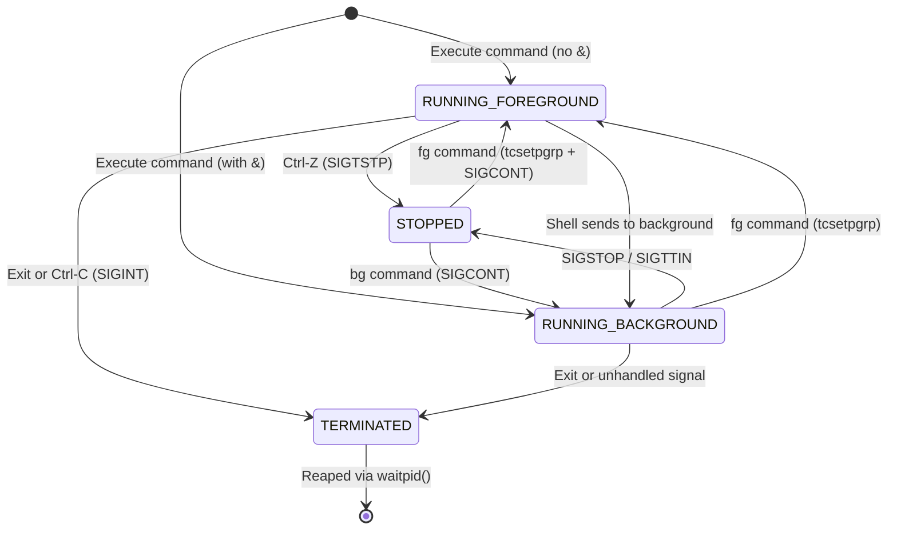

# POSIX Job Control & Terminal Arbitration in Shellcraft

This document provides a comprehensive analysis of POSIX process groups, terminal arbitration, signal interactions, and the job control state machine implemented in **Shellcraft**.

---

## 1. Operating System Concepts: Sessions, Process Groups, and Terminals

To understand job control, three fundamental Unix abstraction levels must be distinguished:

```
[Session (SID)] ── Created by login manager or terminal emulator
      │
      ├── Controlling Terminal (/dev/pts/X)
      │         │
      │         ├── [Foreground Process Group (PGRP)] ◄── Controlled via tcsetpgrp()
      │         │     └── Has read/write access to TTY; receives keyboard signals (Ctrl-C, Ctrl-Z)
      │         │
      │         └── [Background Process Groups (PGRP)]
      │               └── Suspended with SIGTTIN on TTY read; suspended with SIGTTOU on TTY write (if TOSTOP set)
```

1. **Session (`SID`)**: A collection of one or more process groups sharing a single controlling terminal. The shell is typically the session leader.
2. **Process Group (`PGID`)**: A collection of related processes (e.g., all processes in a single pipeline `cat file | grep pattern | wc -l`) identified by a common Process Group ID. Signals sent via `kill(-pgid, SIG)` are broadcast simultaneously to every process in the group.
3. **Controlling Terminal**: A character special device that arbitrates terminal input/output and generates keyboard-generated signals:
   - `Ctrl-C` $\rightarrow$ Kernel transmits `SIGINT` to the foreground process group.
   - `Ctrl-Z` $\rightarrow$ Kernel transmits `SIGTSTP` to the foreground process group.
   - `Ctrl-\` $\rightarrow$ Kernel transmits `SIGQUIT` to the foreground process group.

---

## 2. Terminal Arbitration: `tcsetpgrp()` and `tcgetpgrp()`

The Linux terminal driver enforces a strict invariant: **only one process group can be in the foreground at any given time**.

### Foreground Execution Workflow
When Shellcraft launches a foreground job:
1. `setpgid(pid, pid)` establishes a new process group with PGID equal to the child's PID.
2. `tcsetpgrp(STDIN_FILENO, pgid)` designates that process group as the terminal's foreground group.
3. The child now receives keyboard input and signal events directly from the kernel terminal driver.
4. The shell blocks on `waitpid(-pgid, &status, WUNTRACED)`.
5. When the job finishes or stops, the shell reclaims the terminal:
   ```c
   tcsetpgrp(STDIN_FILENO, shell_pgid);
   tcsetattr(STDIN_FILENO, TCSADRAIN, &shell_tmodes);
   ```

### Why `SIGTTIN` and `SIGTTOU` Exist
If a background process attempts to read from standard input without terminal ownership:
- The terminal driver intercepts the read operation and sends `SIGTTIN` to the background process group.
- By default, `SIGTTIN` suspends the process group until the user brings it to the foreground with `fg`.
- Similarly, if `TOSTOP` is enabled in `termios.c_lflag`, background write attempts generate `SIGTTOU`.

---

## 3. The Job Control State Machine



### State Definitions:
- **`RUNNING_FOREGROUND`**:
  - Process group possesses controlling terminal (`tcsetpgrp`).
  - Shell is waiting for completion or suspension.
- **`RUNNING_BACKGROUND`**:
  - Process group runs concurrently with shell.
  - Shell retains controlling terminal.
  - Asynchronous status updates are printed upon completion.
- **`STOPPED`**:
  - Process execution is suspended by the kernel.
  - Retained in job table with preserved `termios` attributes.
  - Resumable via `fg` or `bg`.
- **`TERMINATED`**:
  - All processes in the job have exited (`WIFEXITED`) or been killed by a signal (`WIFSIGNALED`).
  - Resource descriptors and table entry are freed during reaping.

---

## 4. Resolving Process Group Creation Races

A subtle race condition occurs if only the parent or only the child calls `setpgid()`:
- **If only child calls `setpgid()`**: The parent might call `tcsetpgrp()` or `waitpid()` before the child executes `setpgid()`, resulting in `EPERM` or waiting on the wrong group.
- **If only parent calls `setpgid()`**: The child might call `execvp()` before the parent executes `setpgid()`. In POSIX, `setpgid()` fails with `EACCES` if a process has already called `execve()`.

### The Dual-`setpgid` Solution:
Shellcraft executes `setpgid()` in **both** parent and child processes:
```c
/* In child: */
setpgid(0, 0);

/* In parent: */
setpgid(pid, pid);
```
Whichever process runs first performs the group assignment; the second call either succeeds idempotently or returns `EACCES` (safely ignored since the group is already set).

---

## 5. Non-Blocking Asynchronous Reaping: Zero Zombies

When background jobs terminate, they enter the `ZOMBIE` state until their parent retrieves their termination status via `waitpid()`.

### Why `wait()` is Insufficient:
- `wait(&status)` blocks indefinitely if any child is still running.
- In a shell with multiple background tasks, blocking halts the REPL.

### Shellcraft's Reaping Loop:
Shellcraft implements `job_reap_zombies()`, invoked before each prompt display and inside the `SIGCHLD` handler:

```c
void job_reap_zombies(ShellState *shell) {
    int status;
    pid_t pid;

    while ((pid = waitpid(-1, &status, WNOHANG | WUNTRACED | WCONTINUED)) > 0) {
        Job *job = job_find_by_pid(shell->jobs, pid);
        if (!job) continue;

        Process *proc = job_find_process(job, pid);
        if (proc) {
            if (WIFEXITED(status)) {
                proc->state = PROCESS_COMPLETED;
                proc->status = WEXITSTATUS(status);
            } else if (WIFSIGNALED(status)) {
                proc->state = PROCESS_COMPLETED;
                proc->status = 128 + WTERMSIG(status);
            } else if (WIFSTOPPED(status)) {
                proc->state = PROCESS_STOPPED;
                job->state = JOB_STOPPED;
            } else if (WIFCONTINUED(status)) {
                proc->state = PROCESS_RUNNING;
                job->state = JOB_RUNNING;
            }
        }

        if (job_is_completed(job)) {
            job->state = JOB_DONE;
            if (!job->notified) {
                printf("[%d]  Done                    %s\n", job->id, job->command_line);
                job->notified = true;
            }
        }
    }
}
```

- **Flags Used**:
  - `WNOHANG`: Return immediately (0) if no child has changed state.
  - `WUNTRACED`: Report children that have stopped (`Ctrl-Z`).
  - `WCONTINUED`: Report children that have resumed (`SIGCONT`).
- **Result**: Immediate child cleanup; zero zombie processes remain in the system process table.
